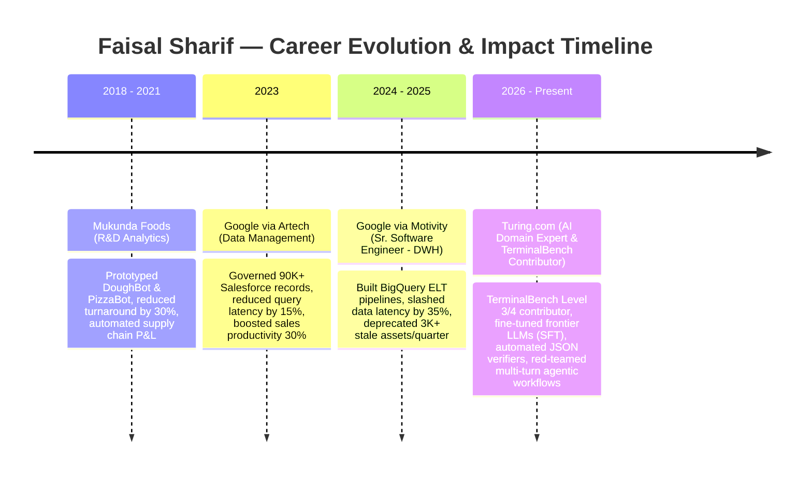

<!--
===================================================================
FAISAL SHARIF (@faisal37990) — HIGH-IMPACT GITHUB PROFILE README
Roles: TerminalBench L3/L4 Contributor | AI Evaluation Engineer | Agentic AI | GCP BigQuery | DevOps & Harbor
===================================================================
-->

  <!-- Animated Header Banner -->
  

  <!-- Animated Dynamic Typing Headline -->
  

  

    <strong>Bengaluru, India 🇮🇳</strong> &nbsp;|&nbsp;
    <strong>5+ Years Experience</strong> &nbsp;|&nbsp;
    <strong>Bridging Enterprise Cloud Data with Frontier AI Alignment & Terminal Benchmarking</strong>
  

  <!-- Hero Badges -->
  

    
    
    
    
    
  

  <!-- Quick Action & Certifications -->
  

    
    
    
    
    
  

  <!-- Animated Interactive Terminal Window Card -->
  

    
  

  <!-- Animated Impact KPI Cards -->
  

    
  

---

### 🌟 Executive Overview

> **High-impact AI Data Engineer, Model Evaluation Specialist & TerminalBench Level 3 & 4 Contributor** with **5+ years of experience** bridging enterprise cloud data platforms (**GCP BigQuery**) with frontier LLM post-training, alignment, and multi-turn terminal execution.
>
> Proven track record fine-tuning (**SFT**) foundation models using complex business analysis case studies, multi-dimensional rubric architectures, Excel/PPT golden solutions, and automated JSON schema verifiers. Specialized in **TerminalBench L3/L4 environments**, containerized evaluation sandboxes (**Docker, Harbor, Kubernetes, Linux CLI**), architecting scalable **ELT/ETL pipelines**, and conducting **adversarial red-teaming** to eliminate hallucinations and stress-test autonomous CLI agents.

---

### 🎭 Core Multi-Disciplinary Profiles

<table>
  <tr>
    <td width="50%" valign="top">
      <h4>💻 TerminalBench L3/L4 & Agentic CLI</h4>
      <ul>
        <li><strong>TerminalBench Level 3 & 4:</strong> Architecting and grading complex multi-turn terminal tasks, system debugging scenarios, CLI agent tool-calling, and shell environment recovery.</li>
        <li><strong>Containerized Sandboxes:</strong> Executing isolated terminal evaluation environments via Docker, Harbor, and ephemeral Kubernetes Pods.</li>
        <li><strong>Golden Script Validation:</strong> Validating agent-generated Bash/Python scripts against deterministic stdout/stderr assertions and exit-code rubrics.</li>
        <li><strong>Autonomous Agent Loops:</strong> Benchmarking planning fidelity, command error-handling, and idempotent state transitions under adversarial constraints.</li>
      </ul>
    </td>
    <td width="50%" valign="top">
      <h4>🎯 AI Evaluation & Alignment Engineer</h4>
      <ul>
        <li><strong>Frontier Model SFT:</strong> Post-training & fine-tuning LLMs with 20+ domain-specific business case studies and multi-dimensional scoring rubrics.</li>
        <li><strong>Automated JSON Schema Verifiers:</strong> Programmatically validating structured JSON model outputs against golden reference standards.</li>
        <li><strong>Adversarial Red-Teaming:</strong> Designing edge-case prompts and safety evaluations to uncover hallucination modes with 100% precision.</li>
        <li><strong>Tooling:</strong> Claude, ChatGPT, Codex, Cursor, Z.ai (GLM), DeepEval, Ragas.</li>
      </ul>
    </td>
  </tr>
  <tr>
    <td width="50%" valign="top">
      <h4>☁️ Big Data & Cloud Data Engineer</h4>
      <ul>
        <li><strong>Google Cloud Platform:</strong> BigQuery, Google Workflows, Data Nexus, Piper Orchestration, Cider Workspace.</li>
        <li><strong>Scalable ELT Pipelines:</strong> End-to-end batch and incremental pipelines with automated schema validation improving data reliability by 30%.</li>
        <li><strong>Dimensional Data Modeling:</strong> Partitioning, clustering, and materialized views reducing query latency by 35% on downstream marts.</li>
        <li><strong>Data Governance & Lineage:</strong> Deprecated 3K+ obsolete warehouse assets quarterly; end-to-end lineage mapping.</li>
      </ul>
    </td>
    <td width="50%" valign="top">
      <h4>🚢 DevOps, Harbor & Kubernetes</h4>
      <ul>
        <li><strong>CNCF Harbor Registry:</strong> Enterprise container registry management, vulnerability scanning with Trivy, role-based access, and image signing.</li>
        <li><strong>Kubernetes Orchestration:</strong> K8s batch evaluation Jobs, ConfigMaps, and automated cron pipelines for scalable model grading.</li>
        <li><strong>Terminal & Shell Automation:</strong> Advanced POSIX Bash scripting, idempotent data backfills, and system diagnostics.</li>
        <li><strong>Container Hardening:</strong> Multi-stage Docker builds optimized for reproducibility and zero leakage during benchmark execution.</li>
      </ul>
    </td>
  </tr>
  <tr>
    <td colspan="2" valign="top">
      <h4>📊 Data Scientist & Business Intelligence Architect</h4>
      <ul>
        <li><strong>Visual Analytics:</strong> Power BI, Looker, Google PLX Dashboards, Salesforce Service Cloud, DAX, Power Query.</li>
        <li><strong>Enterprise MDM:</strong> Cleansed, enriched, and audited 90K+ global customer records using D&B/Hoovers & CRM data.</li>
        <li><strong>Statistical & Performance Analysis:</strong> P2P vendor analytics, P&L analytics, and machine downtime modeling reducing turnaround by 30%.</li>
      </ul>
    </td>
  </tr>
</table>

---

### 🛠️ Interactive Tech Stack Arsenal

  <!-- Skill Icons Dynamic Matrix -->
  

    
  

#### 💻 TerminalBench, Agentic AI & LLM Alignment

  
  
  
  
  
  
  

#### ☁️ Cloud Data Engineering & Distributed Systems

  
  
  
  
  
  
  

#### 🚢 DevOps, Harbor, Containers & Terminal CLI

  
  
  
  
  
  

#### ⚡ Languages, Database Engines & Querying

  
  
  
  
  
  
  

---

### 💼 Professional Journey & Landmark Impact

#### 🏛️ Proven Quantifiable Results:
- 💻 **TerminalBench L3/L4 Contributor:** Designed rigorous multi-turn CLI execution tasks and programmatic grading harnesses for frontier agent alignment.
- 🎯 **100% Precision Adversarial Red-Teaming:** Engineered edge-case evaluation benchmarks that successfully isolated multi-turn reasoning failures in frontier models.
- ⚡ **35% Latency Reduction:** Refactored BigQuery storage layers (partitioning, clustering, views) for CSCD data marts powering Looker and Google PLX.
- 🛡️ **30% Reliability Bump:** Introduced automated schema validation & idempotent backfills across Data Nexus, Piper, and BigQuery ELT pipelines.
- 🧹 **12K+ Assets Cleaned / Year:** Spearheaded quarterly enterprise governance deprecating 3,000+ obsolete data objects and mapping end-to-end lineage.

---

### 🚀 Featured Flagship Repositories

| Project | Focus Area | Technologies | GitHub Link |
| :--- | :--- | :--- | :--- |
| **`terminal-bench-evaluator`** | 💻 **TerminalBench L3/L4 CLI Harness** | Python, Bash, Docker, TerminalBench Rubrics |  |
| **`agentic-llm-eval-suite`** | 🤖 **AI Evaluation & Multi-Turn Alignment** | Python, JSON Schema, Docker, Claude/GPT APIs |  |
| **`gcp-bigquery-elt-pipeline`** | ☁️ **Cloud Data Engineering & DWH** | BigQuery, SQL, Google Workflows, Docker, Bash |  |
| **`k8s-harbor-ml-containers`** | 🚢 **Harbor Registry & Kubernetes CI/CD** | CNCF Harbor, Kubernetes, Docker, Helm, Shell |  |

---

### 🌐 Open Source Footprint & Ecosystem Contributions

Active contributor, fork maintainer, and collaborator across top-tier open source ecosystems in **Terminal Benchmarking, Harbor Registry, AI Evaluation, and Cloud Data Engineering**:

  
  
  
  
  
  
  
  

---

### 📈 Dynamic Analytics & GitHub Telemetry

  <!-- GitHub Streak Stats -->
  

    
    
  

  <!-- Top Languages & Activity -->
  

    
    
  

  <!-- Activity Graph -->
  

    
  

---

### 💬 Connect & Collaborate

Whether you're looking to benchmark **TerminalBench L3/L4 agent workflows**, architect **GCP BigQuery cloud pipelines**, deploy **hardened Harbor registries**, or red-team **frontier LLM models** — let's connect!

  
  
  

<!-- Animated Footer Wave -->

